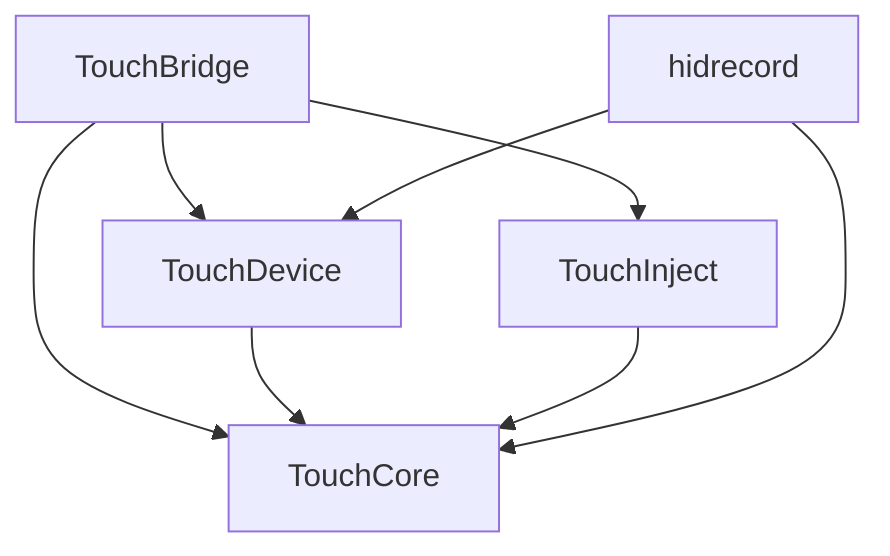
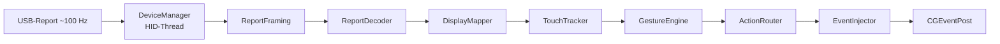

# Architektur

[← Zurück zur README](../README.md)

## Überblick

TouchBridge ist eine einzelne signierte Menüleisten-App (`LSUIElement`-Verhalten via `.accessory`-Aktivierungsrichtlinie) ohne Daemon und ohne root. Der Code ist als Swift Package in fünf Targets gegliedert; die gesamte Logik ohne System-Abhängigkeiten liegt in `TouchCore` und ist vollständig unit-testbar.

## Module

| Modul | Art | Abhängigkeiten | Inhalt |
| --- | --- | --- | --- |
| TouchCore | Library | Foundation | HID-Descriptor-Parser, `TouchScreenLayout`, `ReportFraming`, `ReportDecoder`, `TouchTracker`, `DisplayMapper`, `GestureEngine`, `GestureConfig`, `ActionRouter`, `Command`, `Settings`, `SettingsStore` |
| TouchDevice | Library | TouchCore, IOKit | `DeviceManager` (Erkennung, exklusives Öffnen, Hotplug, Feature-Reports lesen), `DeviceEvent`, `DeviceInfo` |
| TouchInject | Library | TouchCore, CoreGraphics | `EventInjector` (Maus, Scroll, Tastatur, Gesten), `MomentumGenerator`, `GestureEventFields` |
| TouchBridge | Executable | alle drei | `AppState`, `PipelineController`, `DevicePipeline`, `DisplayResolver`, `PermissionCoordinator`, Views, `Windows` |
| hidrecord | Executable (CLI) | TouchCore, TouchDevice | Aufzeichnung roher Reports als JSON-Zeilen |

## Datenfluss

Pro Gerät läuft die Verarbeitung auf einer seriellen Queue (laut Spec). Die Engine ist deterministisch: Zeit stammt ausschließlich aus Frame-Zeitstempeln und `tick`-Aufrufen (Spec: alle 20 ms, solange Kontakte oder Gesten aktiv sind). Long-Press, Doppeltap-Fenster und Stuck-Timeout werden daraus abgeleitet. UI-Zustand wird über `@MainActor`-`@Observable` (`AppState`) aktualisiert.

## Komponenten

- **HIDDescriptorParser / TouchScreenLayout**: Liest den Report-Descriptor und ermittelt Slots (Contact-ID, Tip-Switch, X, Y), Contact-Count, Scan-Time und logische Maxima. Nicht unterstützte Geräte erzeugen einen klaren `LayoutError`.
- **ReportFraming**: Entfernt das führende Report-ID-Byte, das IOKit mitliefert.
- **ReportDecoder**: Erzeugt `TouchFrame`s; unterstützt Hybrid-Modus (Contact-Count 0 in Folgereports) mit Timeout und verwirft unplausible Zählungen.
- **DisplayMapper**: Digitizer-Einheiten → globale CG-Koordinaten mit Orientierung (0/90/180/270) und Kalibrierung, Werte werden geklemmt.
- **TouchTracker**: began/moved/ended-Events, Stuck-Timeout (Standard 500 ms).
- **GestureEngine**: Zustandsautomat über der Fingerzahl, liefert `Action`s (Cursor, Klick, Drag, Scroll, Momentum, Magnify, Rotate, Swipe).
- **ActionRouter**: Wandelt `Action`s in `Command`s; Swipes werden auf Tastenkürzel (Ctrl+Pfeile) abgebildet, Scrollrichtung ist umschaltbar.
- **EventInjector**: Öffentliche CGEvent-API für Maus/Scroll/Tasten; Magnify/Rotate über undokumentierte Felder (`GestureEventFields.swift`). Eigene Events tragen eine Markierung in `eventSourceUserData`.
- **MomentumGenerator**: Erzeugt Abklingframes (60 Hz) nach dem Loslassen.
- **PermissionCoordinator**: Prüft/fordert Input Monitoring und Accessibility, pollt alle 2 s.
- **DisplayResolver**: Wählt das Zieldisplay (`auto` = erstes nicht eingebautes) und meldet Konfigurationsänderungen entprellt (300 ms).

## Fehlerverhalten

| Fall | Verhalten |
| --- | --- |
| Gerät abgesteckt | Geste abbrechen, Pipeline beenden, Status „kein Gerät" |
| Exklusiver Zugriff scheitert | Shared-Öffnen, Menüsymbol gelb |
| Rechte entzogen | Pipeline pausiert, Onboarding erscheint einmal |
| Display-Änderung | Mapping neu berechnen |

## Geplante Erweiterungen

In `docs/superpowers/specs/` ist ein Profil-/Einstellungsfenster-Konzept (Schema 2, App-Profile, `ProfileResolver`) beschrieben. Im vorliegenden Code ist es **noch nicht umgesetzt** (Annahme anhand der Tests, die Schema 1 prüfen).
